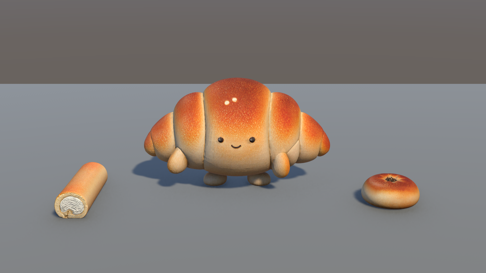

# Bakery 3D — AI 에셋 게임용 정리

VARCO 3D로 생성한 빵 3종(캐릭터 1 + 소품 2)을 Blender에서 게임용으로 정리하고 Unity 6 (URP)에서 검증한 포트폴리오 프로젝트입니다.
2026 대전 KNDA 게임 개발 과정 · 제1차 성취도 평가(블렌더 기초)



## 게임 콘셉트

빵집을 배경으로, 걸어 다니는 크루아상 캐릭터가 빵 아이템을 모으는 3D 게임을 목표로 합니다.
이번 단계에서는 게임 전체가 아니라 **모델 3개를 게임에서 바로 쓸 수 있는 상태로 정리**하는 것까지 진행했습니다.

## 모델 3개

| 모델 | 역할 | 면 수 (전 → 후) | 게임 크기 | 최종 FBX |
|---|---|---|---|---|
| 크루아상 캐릭터 | 플레이어 캐릭터 (Idle · Walk) | 50,000 → 15,000 | 키 1.0m | `Assets/After/croissant/croissant.fbx` |
| 단팥빵 | 아이템 | 500,000 → 10,000 | 지름 0.5m | `Assets/After/anpan.fbx` |
| 롤케이크 | 아이템 | 50,000 → 12,500 | 길이 0.8m | `Assets/After/swissroll/swissroll.fbx` |

- 원점: 세 모델 모두 바닥 중앙 / 앞 방향: Unity +Z / Scale 1 확정
- 텍스처: 모델 이름을 앞에 붙여 정리 (`anpan_`, `swissroll_`, `croissant_`)
- 재질: Unity URP Lit, Smoothness 0.2로 세 모델 질감 통일

## 정리 과정 요약

1. 원본 점검 — 구멍·뒤집힌 면·떨어진 조각 없음, 텍스처 경계에서 점이 갈라져 있음을 발견
2. 갈라진 점 합치기 (Merge by Distance 0.00001m) — 면 수를 줄일 때 틈이 생기지 않게
3. 면 수 줄이기 (Decimate) — 모델별로 비교 렌더 후 비율을 다르게 결정 (2% / 25% / 30%)
4. 롤케이크 표면 접힘 수정 — 면을 줄이며 생긴 자국을 찾아 그 부분만 다듬음
5. 게임 크기 맞추기 + Apply Scale
6. 크루아상 뼈대 6개와 반복 동작 Idle(2초) · Walk(1초) 제작
7. FBX 내보내기 → Unity에서 노멀맵 얼룩, 텍스처 이름 겹침 문제를 찾아 해결
8. 같은 조명·같은 각도로 수정 전후 비교 촬영

자세한 기록: [`Bakery3D_Pipeline/records/edit_log.md`](Bakery3D_Pipeline/records/edit_log.md)

## 폴더 구조

```
Assets/
  After/        수정 후 모델 (최종 FBX + 텍스처 + 재질)
  Before/       VARCO 3D 원본 (비교용)
  Scenes/       Compare_Anpan / Compare_Swissroll / Compare_Croissant
  Editor/       비교 장면·사진 자동화 도구 (Bakery 메뉴)
Bakery3D_Pipeline/
  scripts/      Blender 작업 코드 (내보내기, 표면 수정, 뼈대·동작)
  records/      작업 기록, 원본 점검표, 확인 사진, Unity 비교 사진
```

## 사용 도구

VARCO 3D · Blender 5.2.2 LTS · Unity 6 (6000.6.0f1, URP) · Claude
